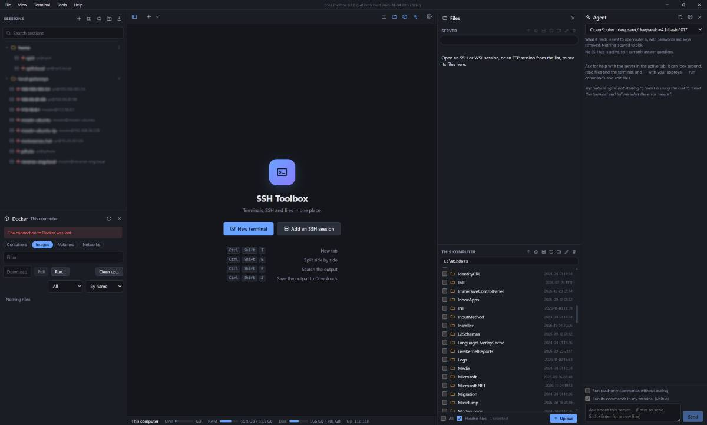

# SSH Toolbox

A lightweight, personal desktop app in the style of MobaXterm, for Windows 11 and Ubuntu 26.04 (macOS later). Built with Tauri 2, Rust, Svelte and xterm.js.

It is a personal project: builds are for the owner's own machines, with no code signing or auto-update.



## What it does

- **Terminals and tabs.** Local shells (PowerShell, cmd, Git Bash, WSL, or the default shell on Linux) in tabs. The window can be split into panes; click a pane and pick which open tab it shows, or start a new terminal or saved session in it. Right-click a tab to duplicate its connection to the right or below, rename it, or move it to its own window. The layout comes back on the next start.
- **SSH sessions.** Saved in folders, with password, key or agent login, jump hosts (up to 3 hops) and a status dot that shows which servers answer. Host keys are checked against `known_hosts`. Give a session a colour and its tab and terminal background use it instead of the theme.
- **Key setup.** Make or pick a key and install it on a server (like `ssh-copy-id`), from the new-session window or the session's menu. Saved secrets go in the OS keychain, never in files.
- **Reconnect.** When a session ends, press `R` to reconnect or `C` to close it.
- **Files.** Browse and copy between this computer and a server over SFTP, FTP or FTPS. Double-click a file to edit it locally; saving sends it back.
- **Port forwarding.** Local, remote and SOCKS forwards per session.
- **X11.** Show windows of programs run on the server (Windows uses VcXsrv, installed separately).
- **Docker.** Containers, images, volumes, networks, logs and shells, on this computer or over SSH.
- **Process monitor.** Opens btop, htop or top for a session.
- **Network tools.** Network scanner and port scanner.
- **Serial ports.** Open a device with its settings.
- **Agent.** An optional assistant for the active SSH server; anything that changes something is shown first.
- **Also:** search and save terminal output, type into all panes at once, import from `~/.ssh/config`, a footer with CPU, memory and disk, and a Help window listing every feature and shortcut.

## Keyboard shortcuts

| Keys | Action |
|---|---|
| Ctrl+Shift+T | New tab |
| Ctrl+Shift+W | Close the active pane |
| Ctrl+Tab / Ctrl+Shift+Tab | Next or previous tab |
| Ctrl+Shift+E / Ctrl+Shift+O | Split side by side / top and bottom |
| Ctrl+Shift+arrows | Move between panes |
| Ctrl+Shift+F | Search the output |
| Ctrl+Shift+S | Save the output to Downloads |
| Ctrl+Shift+B | Type into all panes |
| Ctrl+Shift+C / V | Copy and paste |

## Running and building

You need Node.js, Rust (stable) and, on Windows, the Visual Studio C++ build tools and WebView2.

```
npm install
npx tauri dev                    # run for development
npx tauri build --no-bundle      # standalone build: target/release/app.exe
npm test                         # frontend tests
cargo test -p toolbox-core       # backend tests
```

Installers are built by CI.

## Project layout

- `crates/core`: the backend logic (SSH, files, Docker, serial, X11), with no Tauri dependency
- `src-tauri`: the Tauri app and its commands
- `src`: the Svelte interface
- `docs`: [plan](docs/PLAN.md), [requirements](docs/REQUIREMENTS.md), [interfaces](docs/INTERFACES.md), [tasks](docs/TASKS.md); decisions are in [NOTES.md](NOTES.md)

## Contributing

This is a personal project and I decide what goes into it. Feature requests and bug reports are welcome as GitHub issues. If you want to send a change, open an issue first so we can agree on it before you write code. Pull requests are merged at my discretion, and by sending one you agree it can be released under the licence below. Please don't include secrets, passwords or keys in issues or code.

Security problems: please report them privately (GitHub's "Report a vulnerability" on the Security tab) rather than in a public issue.

## Licence

[Apache License 2.0](LICENSE). You may use, copy and modify it, including commercially, under the terms of that licence. The software comes with no warranty.

## Status

Windows is the tested platform. The Ubuntu rendering check has not been run yet, and macOS is untested.
